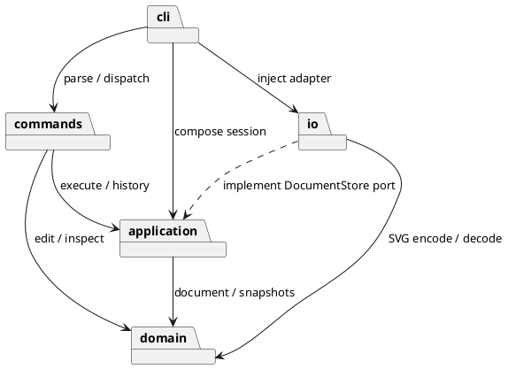

# Lab1 Phase 1：SVG 编辑器（CLI）

**Git 仓库地址：待补充。当前仅有本地 Git 仓库，尚未创建或关联远程仓库。**

本文件是课程提交文档。实现语言为 TypeScript，采用面向对象、Command、Composite 和基于深拷贝的 Memento。代码、测试与本文档均在本地完成；远程推送和 `final` 标签留待仓库地址确定并完成最终确认后处理。

## 运行与功能范围

环境要求：Node.js 24 或更新版本。使用 Node 的原生 TypeScript 类型剥离能力直接执行 `.ts`，另以 TypeScript 严格模式做静态检查。

```bash
npm install
npm run cli
npm run check
```

如使用 pnpm，可执行 `pnpm install --frozen-lockfile`；项目提供 `pnpm-lock.yaml`。此电脑暂未配置系统 Node/npm，开发时使用应用自带的 Node v24.22.1，依赖已经安装。可以直接从项目根目录执行：

```bash
./svg-editor
./scripts/check.sh
./svg-editor < examples/flowchart.commands
```

入口脚本优先使用 PATH 中的 Node，否则尝试当前用户的 Codex Node 运行时。换电脑仍需安装 Node 和项目依赖，不能假设存在这个备用路径。交互模式显示 `svg> `；`Ctrl-D` 或 `Ctrl-C` 结束。脚本模式支持空行和整行 `#` 注释，省略提示符；命令失败后继续处理，脚本最终退出码为 1。

支持 `rect`、`circle`、`ellipse`、`line`、`text`、`g`。命令包括：

| 类别 | 命令 | 历史行为 |
| --- | --- | --- |
| 文档 | `init [w] [h]`、`read <file>`、`save [file]`、`canvas w h` | 成功后清空旧历史并禁止 undo/redo，直到下次成功编辑 |
| 编辑 | `create`、`delete`、`move`、`scale`、`set`、`group`、`ungroup`、`addto`、`front`、`back` | 每条命令一个撤销单元 |
| 显示 | `tree [id]`、`show <id>`、`help`、`canvas` | 不入历史，也不清空 redo |
| 历史 | `undo`、`redo` | 撤销后发生新的成功编辑，清空 redo |

完整参数可在 CLI 输入 `help` 查看。保存后的 `.svg` 可直接在浏览器打开。

## 架构方案

### 模块划分

```text
lab1/
├── src/
│   ├── domain/       # 图形、多态行为、组合树、文档不变量
│   ├── application/  # 会话、历史、端口和共享 Token
│   ├── commands/     # Command 子类与显示格式化
│   ├── io/           # XML/SVG 编解码与文件适配器
│   └── cli/          # 分词、命令注册、REPL、装配入口
├── test/             # 功能测试、SVG 测试、真实 CLI 集成测试
├── scripts/          # 架构检查与本机验证入口
├── examples/         # 课程命令脚本与外部 SVG 样例
├── doc/              # 提交文档、架构图及验证输出
├── svg-editor        # 可执行的本机启动入口
└── README.md         # 项目入口说明
```

| 模块 | 主要类 | 职责 |
| --- | --- | --- |
| domain | Shape、GeometryShape、六个具体 Shape、SvgDocument、ShapeFactory、Values | 封装图形字段及行为；管理父子关系、ID 唯一性、分组和顺序；提供深拷贝 |
| application | EditorSession、History、DocumentStore、ReversibleEdit、Token | 管理当前文档、文件路径和历史；用接口隔离文件适配器与具体命令 |
| commands | Command、EditingCommand、19 个命令类、TreeFormatter | 封装一次用户操作、验证参数、执行编辑或显示结果；编辑命令持有撤销／重做快照 |
| io | SvgCodec、SvgXmlReader、SvgElement、Transform、NodeDocumentStore | 严格 XML 解析、缺失 ID 分配、受支持变换的归一化、SVG 转义与原子文件替换 |
| cli | Lexer、CommandRegistry、CommandEngine、Cli | 处理引号和注释、按命令名创建 Command、统一错误输出、读入终端行；注入 IO 实现 |

应用类一类一文件，文件名与类名一致；接口也各自独立。`main.ts` 只负责启动 Cli，没有额外类。测试使用 Node 标准测试 API。

### 包图


可编辑的 PlantUML 源码保存在 [architecture.puml](architecture.puml)：



### 设计模式的选择及落地

**Command（必选）**：CommandRegistry 每次分发都创建一个新的命令对象，而不是复用带历史状态的实例。全部编辑命令继承 EditingCommand。基类先深拷贝当前文档，在候选副本上调用多态 `apply`；只有完整成功后，才把候选文档及命令一起提交到 EditorSession。失败不会覆盖当前文档、占用 undo 单元或清空已有 redo。即使缩放在修改了部分子孙后遇到数值溢出，原文档仍然完整保留。

**Memento**：每个成功编辑命令保存前后两份文档快照，History 只依赖 ReversibleEdit 接口。undo/redo 恢复快照，不通过反向计算猜测原状态。分组、删除子树和 z-order 均能恢复原父容器和原顺序；一条 group 命令整体算一个单元。代价是保存 H 条历史、每份文档 N 个元素时，空间为 O(HN)，本阶段接受这一取舍；暂未实现历史上限或差量存储。

**Composite**：GroupShape 和叶子统一继承 Shape。命令面向 `Shape.move/scale/set` 等方法；GroupShape 对移动与缩放递归委派给子节点。容器删除由文档摘除整棵子树完成。组的 `fill/stroke/stroke-width` 按 SVG 容器属性保存，子元素可继承；子元素自己的显式属性优先。组没有叶子几何属性，设置 x 等不在白名单中的属性仍会报错。

**Factory**：ShapeFactory 使用类型名到构造器的映射创建具体图形，再调用多态 configure。各具体类决定自身几何属性、可选颜色、移动方式和复制方式。没有到处出现 `switch(tag)` 的图形行为分派，也没有把所有字段暴露成可任意修改的公共对象。

**端口与适配器**：EditorSession 接收 DocumentStore 接口，实际文件操作位于 NodeDocumentStore；测试可注入内存适配器。SVG 文件保存采用同目录临时文件加 rename，写入失败时不更新会话文件路径、不设置历史屏障，正常失败路径会清理临时文件。

本阶段保留的两处名字分派列为后续重构点：

| 位置 | 当前做法 | 后续变化 |
| --- | --- | --- |
| cli/CommandRegistry.ts | 命令名 → 新 Command 的创建器 | 增加注册接口或独立装配模块，以便新交互通道复用 |
| domain/ShapeFactory.ts | 类型名 → 六种内置图形构造器 | 改造成 ShapeProvider 注册，接收参数 schema、创建及读回策略 |

Transform 对 translate/scale 的解析属于 SVG 输入语法解析；图形操作与序列化继续使用对象多态和容器能力，不另建类型名分发器。

### 依赖方向规则

| 模块 | 允许依赖 | 理由 |
| --- | --- | --- |
| domain | domain | 领域行为可独立测试，不认识文件、终端、XML 或历史管理 |
| application | application、domain | 会话只认识领域对象及本层端口；不能反向依赖具体命令或 IO 实现 |
| commands | commands、application、domain | 命令编排领域行为及会话操作；不能直接读写文件，也不能依赖 CLI 分词器 |
| io | io、application、domain；Node 内置库、sax | 作为外部适配器实现应用端口，负责输入输出与格式处理 |
| cli | cli、commands、application、io、domain；Node 内置库 | 最外层入口负责装配依赖、终端交互和错误呈现 |

Token 放在 application 层，让 Lexer 和 Command 共享参数对象而无需 commands → cli。应用层引用的是本层 ReversibleEdit 接口，并未导入 EditingCommand 实现。IO 对 application 的依赖是实现 DocumentStore 端口，这一方向为预期设计。

违反这些规则的导入即待处理项。`scripts/CheckArchitecture.ts` 检查源码静态 import、模块方向与类名，不承诺识别未来新增的任意动态 import；本次代码没有动态 import。

### 变化点假设

| 可能变化 | 本阶段保留的能力或明确取舍 |
| --- | --- |
| 增加图形或 box 插件 | 把类型分派集中在工厂，图形行为留在多态类中；尚未实现完整插件加载、参数 schema 或 box 语义，避免提前声称可零修改扩展 |
| CLI 之外增加 GUI/agent | 会话、领域模型、命令不依赖 readline；未来可复用命令类，但 Token 参数表示仍需评估是否改成更强的请求类型 |
| 文件系统改成内存、云端或其他格式 | 通过 DocumentStore 注入适配器；本阶段接口同步，未来远程异步 IO 需要调整端口和调用链，未预先引入 Promise |
| 文档规模与历史条数增长 | 提供深拷贝接口替换点；先选可靠的快照语义，未实现增量命令和历史压缩 |
| 外部 SVG 语法增多 | XML 解析和领域构建在 IO 层隔离；对不支持的语法明确失败，未用保留未知字符串的方式绕开编辑语义 |
| 样式和变换的完整 SVG 兼容 | 已支持基本颜色继承和有限变换归一化；完整 CSS、矩阵和字体布局不属本阶段，不为其引入渲染引擎 |

## 关键语义与决策

- ID 大小写敏感、不能为空或包含空白。CLI 必须显式命名，外部 SVG 缺失 ID 才自动分配；空字符串 ID 被视为非法，不能混同于缺失。
- 自动补 ID 分两遍：先收集文件内全部显式 ID 并检查重复，再按文档顺序分配 `标签名+序号`，跳过已保留的名字，并输出警告。
- 所有 create 都支持末尾的 `in <containerId>`。分词保留引号信息，文字 `"in"` 不会被误认为归属子句；支持空文字、双引号和反斜杠转义。
- move 使用增量；scale 要求正有限数，并乘到所有几何属性。stroke-width 和读入的 font-size 不属于 CLI scale 的几何属性范围。
- front 把图形移到同级列表末尾，后绘制因而显示在前面；back 放在列表开头。
- group 按原文档深度优先顺序收编，不按参数顺序重排。共同父容器相同时，新组占据第一个被收编节点的位置；跨父容器时，新组追加到画布根。禁止一次选择某个容器及其后代，也禁止重复选择同一 ID。
- addto 把图形追加到目标组末尾，禁止制造循环。ungroup 原位提升子节点；按课程明确规则，画布直接子组禁止解散。Phase 1 不创建 box，因此没有可供判定的插件所有权复合类型；带 data-kind 的外部 g 降级为普通组并警告。
- 成功的 `init/read/save/canvas w h` 同时清空两侧历史并设置屏障；canvas 查询、tree/show/help、失败命令不改变屏障与历史。下一条成功编辑解禁，且不会恢复屏障前的历史。

### SVG 读写边界

这是六种基础图形的编辑器，不是完整 SVG 浏览器或任意 SVG 的无损编辑器。支持单位为 px 的无单位数值（包含小数和科学记数），基础几何属性、fill/stroke/stroke-width，以及 text 内容；额外保留导入 text 的数值 font-size 和 text-anchor。set 仍严格遵循课程白名单，不能通过它修改这两项导入属性。

支持嵌套 translate 和正数等比 scale，按 SVG 组合顺序归一化到叶子坐标；导入时同步处理已知 stroke-width 与 font-size 的变换缩放。原始 transform 字符串不会保留。经过缩放的继承描边宽度可能会固化为叶子的显式属性，后续再修改组描边宽度时仍遵循显式子属性优先的 SVG 规则。

根 viewBox 如存在，须对应 `0 0 width height`。不支持旋转、倾斜、非等比缩放、任意 viewBox 映射、CSS/style、path/polygon、defs/use、脚本、嵌套 tspan、带 px/% 等后缀的尺寸或其他完整 SVG 特性；遇到这些输入会报错并保留原文档。XML 使用 sax 严格解析，拒绝 DTD 和外部命名空间；文本和属性按 XML 规则转义，注释不进入图形模型。未知属性也不会被静默丢弃后假装无损读回。

## 过程记录

以下记录实际发生的用户确认、AI 自查与实现调整，没有把未发生的讨论写成用户决策。

| 日期 | 问题／证据 | 处理与结果 |
| --- | --- | --- |
| 2026-10-26 | 初始聊天位于无关 EasyGraph 工作目录，用户说明放错项目 | 仅做只读检查，没有修改 EasyGraph；后由用户指定当前 lab1 空目录 |
| 2026-10-26 | 用户确认代码和仓库都尚未开始，要求先完成本地代码及文档 | 在写代码前初始化 Git；分步提交方案、模型、命令、IO/CLI 和测试；远程地址保留为真实待办 |
| 2026-10-26 | 方案需同时满足面向对象、Command、容器与叶子的统一行为 | 采用 Shape 多态、Composite 和编辑命令模板；先记录方案再实现 |
| 2026-10-26 | AI 自查：group/delete 的反向操作需恢复原父容器和确切位置，手工逆操作易漏状态 | 使用文档前后快照；用撤销一次恢复跨父容器分组、删除子树和 z-order 的测试确认语义 |
| 2026-10-26 | AI 自查：边读文件边补 rect1 可能和后面显式的 rect1 冲突 | 改为预留所有显式 ID 后再补缺失 ID；加入“后面的节点已占名”回归测试 |
| 2026-10-26 | AI 代码检查发现：若导入时把所有继承颜色复制到叶子，之后修改组颜色就会失效 | 保留 fill/stroke 的原有继承关系，仅在归一化缩放确有需要时固化描边宽度；测试验证子叶不新增 fill |
| 2026-10-26 | AI 自查：深层数值溢出可能留下已修改的部分结果 | 当前文档始终不参与候选修改；通过组内后续子节点溢出的用例检查失败前后序列化完全一致，redo 仍可执行 |
| 2026-10-26 | 当前终端无系统 node/npm，网络沙箱初次阻止依赖安装 | 使用应用自带 Node v24.22.1，安装固定版本依赖；提供可检测本机运行时的入口，保留标准 npm 运行方式 |
| 2026-10-26 | 首轮实现完成 | TypeScript 严格检查、依赖检查与 46 项测试通过；真实子进程回放两节点脚本，保存／读回得到 8 个元素，节点移动撤销后坐标正确 |

### 方案修订

1. IO 模块进一步拆成 XML 树读取、SVG 语义编解码、变换解析和文件适配器，职责保持在原定 IO 边界内。
2. 增加共享 Token 和 ReversibleEdit 接口，防止命令反向依赖 CLI、应用反向依赖具体命令。最终依赖规则收紧为 commands 不依赖 io；io 通过实现 application 的端口接入。
3. 增加 scripts 的静态架构检查和本机启动脚本，服务验证与环境适配，不参与领域行为。
4. 明确 SVG 支持子集、跨父容器 group 的位置规则和快照内存成本；这些属于本阶段主动取舍，未声明实现后续插件阶段。

## 一致性自查

### 1. 实际模块划分是否与方案一致？

一致。五个源码模块均已实现，没有用单个上帝类吸收领域、历史和 IO。后增加的接口、IO 内部拆分及验证脚本均已列入上面的修订记录。

检查脚本确认 **48 个源码文件**中的类名与文件名一致、每个文件至多一个导出类；没有公开可直接修改的几何属性数据袋。attributes 和 children 返回快照，具体修改经对象方法完成。接口和启动文件不强制包含类。

### 2. 是否违反依赖方向？

当前静态导入检查通过：检查 **166 条 import**，未发现违反规则的依赖。抽样检查如下：

| 样本 | 实际依赖 | 结论 |
| --- | --- | --- |
| domain/GroupShape.ts | Shape、Values | 只依赖领域层 |
| domain/Shape.ts | 类型导入 GroupShape、Values | 不依赖 Node、IO 或应用层；父关系引用不形成运行时反向循环 |
| application/EditorSession.ts | SvgDocument、History、本层 DocumentStore/ReversibleEdit | 未导入具体命令和文件实现 |
| commands/EditingCommand.ts | Command、应用接口、领域文档类型 | 候选副本上执行命令，不读取终端或文件 |
| io/NodeDocumentStore.ts | Node 文件库、DocumentStore 端口、SvgCodec | 外层实现应用端口，符合方向 |
| cli/Cli.ts | readline、EditorSession、NodeDocumentStore、CommandEngine | 在入口装配并注入依赖 |

命令／图形类型的名字分派集中在前述两个注册表；容器判定使用 instanceof GroupShape 表达组合能力，不按标签字符串分配图形行为。

## 质量保证手段

在 Node v24.22.1、TypeScript 5.9.3 下运行。可复现命令为 `npm run check`，本机等价入口为 `./scripts/check.sh`。最近一次实际输出见 [validation.txt](validation.txt)。

| 检查 | 覆盖内容 | 结果 |
| --- | --- | --- |
| 严格类型检查 | strict、无隐式 any、数组索引检查、NodeNext、仅可擦除 TS 语法 | 通过 |
| 架构检查 | 48 个源码文件、166 条导入、模块依赖规则、一类一文件命名 | 通过 |
| 编辑器功能与历史测试 | 六种图形、19 命令、参数校验、嵌套 move/scale、分组顺序、循环拒绝、删除恢复、redo 清理、IO 屏障及失败原子性 | 通过 |
| SVG 和文件系统测试 | 课程外部样例、自动补 ID、中文/转义/空文字往返、变换归一化、样式继承、非法 XML/属性/类型拒绝、实际文件读写与临时文件清理 | 通过 |
| 真实 CLI 集成测试 | Node 子进程通过 stdin 回放两节点流程图，验证保存文件的 8 个元素和恢复坐标；错误后继续运行且返回退出码 1 | 通过 |
| 自动化测试总数 | Node 标准测试运行器 | **46 通过，0 失败** |

测试重点检查可观察行为和错误后的完整状态，而非仅断言实现内部调用次数。对失败的编辑、非法 SVG、数值溢出和失败 IO，均检查当前文档或历史未被覆盖。测试不能代替对所有 SVG 文件的兼容性承诺；本阶段外部格式范围如上明确限定。

## Git 与交付状态

本地 main 分阶段提交，查看 `git log --oneline` 可见真实迭代。由于此电脑没有配置 Git 作者身份，自动开发提交使用临时身份 `Codex <codex@local.invalid>`，通过每次提交的局部参数指定，没有修改全局 Git 配置；不冒用用户姓名或邮箱。之后用户可配置自己的仓库级身份，用于后续真实提交。

本地代码和文档已实现并验证。完整课程提交仍需以下信息和动作：

1. 创建 GitHub 或 Gitee 远程仓库，将本文与根 README 中的待补充位置替换为真实 URL。
2. 关联 remote 并推送已有提交，保留目前分步历史。
3. 最终确认后，在课程截止时间前创建并推送名为 final 的标签；截止日期尚未提供，不推测或虚构。

本地尚未创建 final 标签，也未声称完成远程推送。课程提交时应交付本文件 doc/README.md，并确保其中仓库链接可以被评阅者访问。
