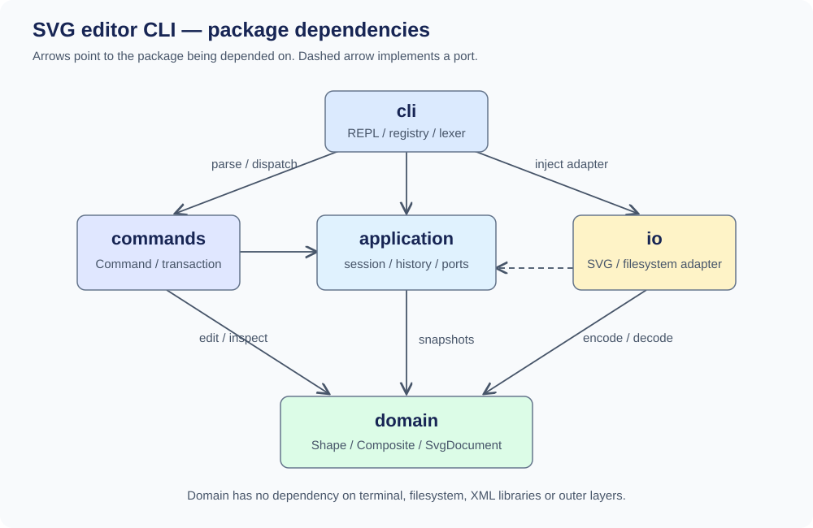

# Lab1 Phase 1：SVG 编辑器（CLI）

Git 仓库地址：**待补充（当前仅有本地仓库，尚未创建远程仓库）**。

## 架构方案

### 模块划分

项目使用 TypeScript 面向对象实现，一类一文件，支持 rect、circle、ellipse、line、text、g 六种图形。

| 目录 | 职责 |
| --- | --- |
| `src/domain/` | 图形类、组合树、ID 唯一性、分组与顺序管理 |
| `src/application/` | 当前文档、文件路径、撤销重做历史及 IO 接口 |
| `src/commands/` | 命令对象、参数校验、编辑与显示操作 |
| `src/io/` | XML/SVG 编解码、缺失 ID 补全、文件读写 |
| `src/cli/` | 分词、命令分发、REPL 和依赖装配 |

`test/` 存放测试，`examples/` 存放课程示例，`scripts/` 提供架构检查和验证入口。

PlantUML 源码：[architecture.puml](architecture.puml)。箭头表示依赖方向。

### 设计模式的选择

- **Command**：每次操作创建独立命令对象。编辑命令继承 `EditingCommand`，在文档副本上执行，全部成功后才提交；失败不改变当前文档和历史。
- **Memento**：命令保存执行前后快照，`History` 据此撤销、重做。一条编辑命令对应一个单元，可完整恢复分组、删除及图形顺序。
- **Composite**：叶子图形与 `GroupShape` 统一继承 `Shape`。组的移动和缩放递归作用于子孙，删除组时删除整棵子树；组样式遵循 SVG 继承规则。
- **Factory**：`ShapeFactory` 负责创建图形，具体类通过多态实现属性校验、移动、缩放和复制。

命令名分派集中在 `CommandRegistry`，图形类型分派集中在 `ShapeFactory`。两处注册表列为后续重构点，计划改为可注册的命令和 ShapeProvider 接口；当前不实现 box 插件。

### 依赖方向规则

| 模块 | 允许依赖 | 理由 |
| --- | --- | --- |
| domain | 本层 | 领域模型不依赖终端、文件系统或上层模块 |
| application | 本层、domain | 管理会话与历史，通过本层接口隔离外部实现 |
| commands | 本层、application、domain | 编排操作，不直接依赖 CLI 或文件实现 |
| io | 本层、application、domain、Node/sax | 实现应用层的 `DocumentStore` 端口并处理格式与文件 |
| cli | 各源码模块、Node | 最外层入口负责装配和终端交互 |

违反上述规则的导入视为待处理项。共享 `Token` 和 `ReversibleEdit` 位于 application 层，避免命令反向依赖 CLI、应用反向依赖具体命令。

### 变化点假设

| 可能变化 | 预留能力或取舍 |
| --- | --- |
| 增加图形或插件 | 集中工厂注册，图形行为使用多态；暂不实现插件加载和 box 语义 |
| 增加 GUI/agent 入口 | 领域、会话和命令独立于 readline，可复用现有操作 |
| 更换存储方式 | 注入 `DocumentStore` 适配器；远程异步存储仍需调整当前同步接口 |
| 大文档与长历史 | 深拷贝可靠但历史空间为 O(HN)，暂不做差量存储和压缩 |
| 扩展 SVG 兼容性 | 编解码隔离在 IO 层；当前只支持基础属性与有限变换，不支持的输入明确报错 |

## 过程记录

2026-10-26，用户确认从零开发，先完成本地代码和文档。开发前初始化 Git，随后分步提交方案、模型、命令、IO/CLI、测试和文档。

| AI 自查发现的问题 | 修正及验证 |
| --- | --- |
| group/delete 的逆操作容易遗漏原父容器或位置 | 使用前后快照；测试确认撤销能恢复父子关系与顺序 |
| 按读取顺序直接补 rect1，可能与后面的显式 ID 冲突 | 先收集全部显式 ID，再补缺失 ID；加入占名冲突测试 |
| 把继承颜色复制到叶子后，修改组颜色会失效 | 保留 fill/stroke 继承；测试确认导入时不额外固化子元素颜色 |
| 深层缩放溢出可能留下局部修改 | 编辑仅修改候选副本；测试确认失败前后文档相同，redo 仍可执行 |

方案修订：IO 内部分拆为 XML 读取、SVG 编解码、变换解析和文件适配器；增加共享接口与架构检查脚本。最终收紧依赖规则，commands 不依赖 io，io 实现 application 定义的端口。

## 一致性自查

1. **模块划分**：实际源码与五模块方案一致。新增接口、IO 内部拆分和验证脚本已记入上述修订记录；48 个源码文件通过类名与文件名检查。
2. **依赖方向**：静态检查覆盖 166 条 import，未发现违规。抽查 `GroupShape` 仅依赖领域层，`EditorSession` 不依赖具体命令和 IO，`EditingCommand` 不读写文件，`NodeDocumentStore` 实现应用端口，符合方案。

## 质量保证手段

在 Node v24.22.1、TypeScript 5.9.3 下完成验证。标准命令为 `npm run check`，本机也可执行 `./scripts/check.sh`；实际输出见 [validation.txt](validation.txt)。

| 检查 | 结果与依据 |
| --- | --- |
| 严格类型与架构检查 | 类型检查通过；48 个源码文件、166 条导入符合依赖和命名规则 |
| 功能与历史 | 覆盖六种图形、19 条命令、组合操作、undo/redo、IO 历史屏障及失败原子性 |
| SVG 与文件读写 | 覆盖 ID 补全、中文/转义/空文字往返、变换、非法输入及读写失败 |
| CLI 集成 | 真实子进程回放课程两节点示例，保存并读回 8 个元素，确认撤销后的坐标正确 |

自动化测试共 **46 项，全部通过**。对失败编辑、数值溢出和失败 IO，另检查文档及历史保持不变。验证范围限于本阶段支持的 SVG 子集，运行说明与兼容性边界见[项目 README](../README.md)。
